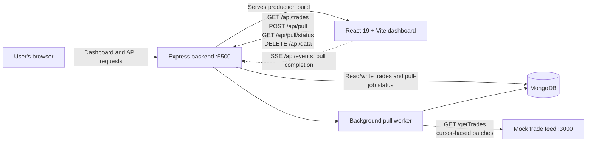

# Trade Desk

Trade Desk is a small full-stack market-trade dashboard. It pulls paginated trade data from a mock BSE-style HTTP feed, stores it in MongoDB, and displays the stored trades in a React dashboard.

> **Data note:** `mock-bse` generates sample data in memory. It is for local development and demonstration only; it is not an official BSE integration or a source of live market data.

## Architecture



### Components

| Component | Responsibility | Main technologies |
| --- | --- | --- |
| `frontend` | Dashboard UI, trade search and pagination, sync controls, and event-driven refresh | React 19, Vite |
| `backend` | HTTP API, MongoDB access, background pull-job orchestration, and production hosting of the built frontend | Node.js, Express 5, Mongoose |
| `mock-bse` | Local mock feed that returns generated trade records in cursor-based batches | Node.js, Express 5 |
| MongoDB | Persistent storage for trades and pull-job status | MongoDB |

### Data flow

1. The dashboard requests stored trades and the latest pull-job status from the backend.
2. When a user starts a sync, the backend creates a `RUNNING` pull job and responds immediately.
3. A background worker requests pages of up to 100 trades from the mock feed and upserts each batch into MongoDB by `tradeId`.
4. The worker updates the job cursor and count as it progresses, then marks the job `COMPLETED` or `FAILED`. If the backend restarts during a pull, it idempotently replays the saved prefix before continuing from the checkpoint so a stale cursor cannot leave earlier trades missing.
5. After each batch has been saved, the backend sends the batch itself and updated progress in a Server-Sent Event. The dashboard immediately adds those trades to the table without waiting for another API read. A separate event reports when the pull completes or fails. There is no polling loop.
6. The dashboard's **Clear all data** action can delete stored trades and pull-job history when no sync is running, allowing the import to be run again.

The event stream is deliberately closed after 25 seconds, below the network's 30-second connection limit. The browser's `EventSource` reconnects automatically, and the backend replays any completion event missed during a reconnect using SSE event IDs. This keeps every individual HTTP connection short without polling for trade updates.

## Requirements

- Node.js with npm
- MongoDB, running locally or reachable through a MongoDB connection URI

## Run locally

Install dependencies in each application directory:

```powershell
cd .\mock-bse
npm install

cd ..\frontend
npm install

cd ..\backend
npm install
```

Configure the backend environment in `backend/.env` (create the file if it does not exist):

```dotenv
DB_URL=mongodb://127.0.0.1:27017/trade-desk
BSE_API_URL=http://localhost:3000
PORT=5500
```

`DB_URL` can also be named `DB_URI`. `BSE_API_URL` and `PORT` are optional; the defaults are `http://localhost:3000` and `5500`. Start MongoDB before starting the backend. Keep real credentials in environment variables and do not commit `.env` files.

Open two PowerShell terminals from the project root:

**Terminal 1 — mock trade feed**

```powershell
cd .\mock-bse
npm start
```

The mock feed listens on `http://localhost:3000`.

The mock feed waits 18 seconds before returning each batch by default. With 5,000 trades and a batch size of 100, this simulates a pull of about 15 minutes while keeping each individual HTTP request below 30 seconds. Set `MOCK_BSE_DELAY_MS` to an integer from `0` to `20000` to adjust the per-batch delay. For example, use `$env:MOCK_BSE_DELAY_MS = "1000"` in PowerShell for a faster demo.

**Terminal 2 — backend and dashboard**

```powershell
cd .\backend
npm start
```

The backend start script builds the frontend and then runs the backend on `http://localhost:5500`. Open that URL in a browser. In development, the frontend can instead be run with `npm run dev` from `frontend`; Vite serves it on its development URL and proxies `/api` requests to the backend at `http://localhost:5500`.

The mock feed generates 5,000 sample trades. Its configurable delay is applied separately to each batch request so no request needs to remain open for the full sync.

## HTTP endpoints

### Backend — default port `5500`

| Method | Path | Description |
| --- | --- | --- |
| `GET` | `/health` | Reports backend and MongoDB connection status. Returns `503` when MongoDB is disconnected. |
| `GET` | `/api/trades` | Returns stored trades, newest first. |
| `POST` | `/api/pull` | Starts a background sync. Returns `202` with a job ID; returns `409` if a pull is already running. |
| `GET` | `/api/pull/status` | Returns the most recently started pull-job record, or `null` if none exists. |
| `DELETE` | `/api/data` | Deletes all stored trades and pull-job history. Returns `409` if a sync is running. |
| `GET` | `/api/events` | Sends batch-arrived and pull-completion/failure events using Server-Sent Events. Connections close after 25 seconds and reconnect automatically; missed events are replayed. |

### Mock feed — port `3000`

| Method | Path | Description |
| --- | --- | --- |
| `GET` | `/health` | Reports mock-feed status and the number of generated trades. |
| `GET` | `/getTrades?cursor=0&limit=100` | Returns a batch of trades with `nextCursor`, `hasMore`, and `totalAvailable` paging metadata. |

## Project layout

```text
.
├── backend/
│   ├── app.js                 # Express app, API mounting, static frontend hosting
│   ├── config/db.js           # MongoDB connection
│   ├── models/                # Trade and pull-job schemas
│   ├── routes/                # Trade and pull-job API routes
│   └── services/              # Paginated background pull worker
├── frontend/
│   └── src/
│       ├── components/        # Dashboard UI components
│       ├── utils/             # Display formatters
│       └── App.jsx            # Dashboard data fetching and state
├── mock-bse/
│   └── server.js              # Generated, paginated mock trade feed
└── README.md
```
